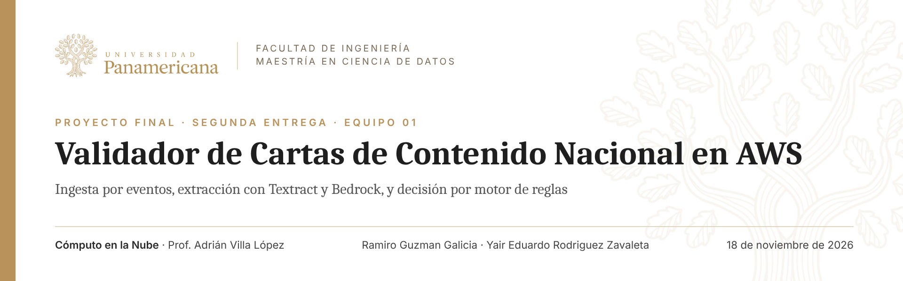
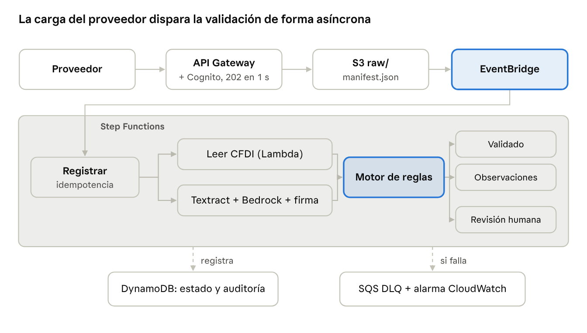

<p align="center">
  
</p>

<p align="center">
  
  
  
  
  
</p>

# E2_EQ01 Validador de Cartas de Contenido Nacional en AWS

| | |
| --- | --- |
| **Materia** | Cómputo en la Nube |
| **Profesor** | Adrián Villa López |
| **Programa** | Maestría en Ciencia de Datos, Facultad de Ingeniería, Universidad Panamericana |
| **Equipo 01** | Ramiro Guzmán Galicia · Yair Eduardo Rodríguez Zavaleta |
| **Entrega** | Segunda entrega, Ruta 1 (técnica) · 18 de noviembre de 2026 |

Solución serverless que recibe Cartas de Contenido Nacional escaneadas (PDF o JPG) y su CFDI 4.0 (XML), extrae los datos con Textract y Bedrock, los valida con un motor de reglas determinista y alimenta un lago de datos en S3 consultable con Athena. Toda la solución está desplegada con CloudFormation en la región **us-east-2 (Ohio)** y se probó con 30 expedientes sintéticos: **29 de 30 decisiones correctas**.

| Documento | Contenido |
| --- | --- |
| Este README | Entrega: Ruta 1, eventos de ingesta, roles, estructura de datos, linaje y costos |
| [`adr/`](adr/) | [ADR-001](adr/ADR-001-entrada-y-almacenamiento.md) entrada y almacenamiento, [ADR-002](adr/ADR-002-procesamiento.md) procesamiento con costo a 12 meses x1 y x3, [ADR-003](adr/ADR-003-formato-curated.md) formato de curated |
| [`evidencias/`](evidencias/) | Capturas de consola y reportes generados por los scripts ([índice](evidencias/LEEME.md)) |

## Arquitectura



| Componente | Servicio | Stack |
| --- | --- | --- |
| Entrada | API Gateway HTTP con autorizador JWT de Cognito; entrega URLs prefirmadas de S3 | `cn-eq01-ingesta` |
| Disparador | EventBridge sobre `raw/expedientes/{id}/manifest.json` | `cn-eq01-ingesta` |
| Orquestación | Step Functions Standard: registrar (idempotencia) → leer CFDI ∥ Textract asíncrono → Bedrock → firma → motor de reglas → revisión humana | `cn-eq01-ingesta` |
| Extracción | Textract (TABLES + SIGNATURES) y Bedrock Converse con esquema JSON (Claude Haiku 4.5; respaldo Amazon Nova Lite) | `cn-eq01-ingesta` |
| Decisión | Lambda `motor_reglas` con 16 reglas FVR: VALIDADO, OBSERVACIONES o REVISION_HUMANA | `cn-eq01-ingesta` |
| Estado | DynamoDB `cn-eq01-expedientes` (tabla única, GSI por estado, TTL, PITR) | `cn-eq01-base` |
| Lago | Bucket `cn-eq01-lago-*` con `raw/`, `curated/` y `athena-results/`, cifrado con KMS | `cn-eq01-base` |
| Curación | Job de Glue `cn-eq01-curar` (Spark, Flex, bookmarks), diario a las 07:00 UTC | `cn-eq01-curado` |
| Consulta | Athena, workgroup `cn-eq01` con límite de 1 GB por consulta | `cn-eq01-base` |

Textract y Bedrock solo extraen datos; el motor de reglas es el único que decide.

| Carpeta | Contenido |
| --- | --- |
| [`infra/`](infra/) | Plantillas CloudFormation por fase (`fase1-base`, `fase2-ingesta`, `fase3-validacion`, `fase4-curado`) |
| [`src/`](src/) | Lambdas: `api`, `expediente`, `leer_cfdi`, `estructurar_carta`, `verificar_firma`, `motor_reglas` |
| [`glue/`](glue/) | Job `curar.py` (raw → curated en Parquet) |
| [`sql/`](sql/) | Consultas de Athena Q1 a Q4 |
| [`datos/`](datos/) | Generador de expedientes sintéticos, catálogo SE (648 códigos) y resultado esperado |
| [`scripts/`](scripts/) | Un script por fase y [`limpiar.sh`](scripts/limpiar.sh) para borrar todo |

## Ruta 1. Construcción en AWS

### 1. Lago de 3 capas y consultas en Athena

| Capa | Prefijo | Contenido |
| --- | --- | --- |
| Cruda | `raw/` | Carta, CFDI y manifest por expediente; extracciones de Textract y Bedrock; resultados del motor en JSON; catálogo SE |
| Curada | `curated/` | Tablas `expedientes`, `conceptos`, `hallazgos` y `catalogo_se` en Parquet particionado por `anio/mes` |
| Resultados | `athena-results/` | Salida de las consultas del workgroup `cn-eq01` |

Evidencia: [`01_s3_capas.png`](evidencias/01_s3_capas.png).

| Consulta | Tabla y formato | Bytes escaneados |
| --- | --- | --- |
| [Q1](sql/q1_raw_json_por_moneda.sql). Expedientes y subtotal por moneda | `cfdi_raw`, JSON en `raw/` | 21,326 |
| [Q2](sql/q2_curated_parquet_por_moneda.sql). Misma consulta | `expedientes`, Parquet en `curated/` | 824 |
| [Q3](sql/q3_curated_particion_octubre.sql). Monto por proveedor en octubre de 2026, con join a conceptos | `expedientes` y `conceptos`, partición `anio=2026/mes=10` | 966 |
| [Q4](sql/q4_curated_catalogo_por_grupo.sql). Códigos del catálogo SE por grupo | `catalogo_se`, Parquet (65,029 bytes en `raw/`) | 354 |

La misma consulta escanea 26 veces menos en Parquet que en JSON (Q1 contra Q2). Athena cobra un mínimo de 10 MB por consulta; a 5 USD por TB, cada consulta cuesta alrededor de 0.00005 USD. Evidencia: [`fase4_resultado.md`](evidencias/fase4_resultado.md), [`02_athena_q3_sql.png`](evidencias/02_athena_q3_sql.png), [`02_athena_q3.png`](evidencias/02_athena_q3.png).

### 2. Tablas con datos estructurados

| Tabla | Servicio | Contenido |
| --- | --- | --- |
| `cn-eq01-expedientes` | DynamoDB | Llave `pk = EXP#id`, `sk = META, RESULTADO o AUDIT`; GSI por estado; TTL `expira_en`; cifrado con KMS |
| `expedientes`, `conceptos`, `hallazgos` | Glue / Athena | Resultado del motor en Parquet, particionado por `anio/mes` |
| `catalogo_se` | Glue / Athena | Catálogo oficial de la Secretaría de Economía en Parquet |
| `cfdi_raw`, `catalogo_se_raw` | Glue / Athena | JSON crudo, para comparar bytes contra Parquet |

Evidencia: [`03_dynamodb_items.png`](evidencias/03_dynamodb_items.png), [`03b_dynamodb_cifrado_ttl.png`](evidencias/03b_dynamodb_cifrado_ttl.png), [`04_glue_tablas.png`](evidencias/04_glue_tablas.png). Diccionario de datos en [Estructura de datos](#estructura-de-datos).

### 3. Job de Glue de raw/ a Parquet particionado

| Parámetro | Valor |
| --- | --- |
| Job | `cn-eq01-curar` ([`glue/curar.py`](glue/curar.py)), Glue 4.0, clase de ejecución Flex, 2 × G.1X, job bookmarks |
| Entrada | `raw/resultados/` (JSON del motor de reglas) y `raw/catalogo_se/` |
| Salida | `curated/{expedientes,conceptos,hallazgos,catalogo_se}/anio=AAAA/mes=M/` en Parquet con Snappy |
| Transformación | Elimina correo y teléfono; reemplaza el nombre del representante por su SHA-256; tipa montos como `decimal` |
| Programación | Trigger diario a las 07:00 UTC; tablas con proyección de particiones |
| Corrida probada | Succeeded en 4 min 16 s, 0.0886 DPU-hora (unos 0.026 USD) |

Evidencia: [`05_glue_job_ok.png`](evidencias/05_glue_job_ok.png), [`06_curated_particiones.png`](evidencias/06_curated_particiones.png) (`anio=2026/mes=9`, `10` y `11`).

### 4. Políticas de almacenamiento y procesamiento para optimizar costos

| Prefijo | Vigencia | Regla de ciclo de vida |
| --- | --- | --- |
| `raw/expedientes/` | 5 años | Standard-IA a los 30 días, Glacier Instant Retrieval a los 90, eliminación a los 1,825 (art. 30 del CFF) |
| `raw/extracciones/` | 1 año | Standard-IA a los 30 días, eliminación a los 365; son regenerables |
| `raw/resultados/` | 5 años | Standard-IA a los 90 días, eliminación a los 1,825 |
| `curated/` | Indefinida | Intelligent-Tiering desde el día 0 |
| `athena-results/` | 7 días | Eliminación automática |
| `glue-temp/` | 3 días | Eliminación automática |
| Todo el bucket | No aplica | Cargas multiparte incompletas abortadas al día 1; versiones anteriores eliminadas a los 30 días |
| DynamoDB | Según TTL | Auditoría y cargas pendientes expiran por el atributo `expira_en` |

| Política de procesamiento | Efecto |
| --- | --- |
| Parquet particionado por `anio/mes` | Athena lee solo las particiones y columnas consultadas (Q3: 966 bytes) |
| Límite de 1 GB por consulta en el workgroup | Evita consultas accidentales de alto costo |
| Glue Flex con bookmarks | Cómputo más barato y solo procesa archivos nuevos |
| Lambdas arm64 | Menor costo por GB-segundo que x86 |
| Bucket Key en KMS | Reduce hasta 99 % las llamadas a KMS |
| Logs de CloudWatch con 14 días | Evita acumulación de logs sin uso |

Evidencia: [`07_lifecycle.png`](evidencias/07_lifecycle.png), [`03b_dynamodb_cifrado_ttl.png`](evidencias/03b_dynamodb_cifrado_ttl.png).

## Eventos de ingesta

| Punto | Respuesta |
| --- | --- |
| A. Evento que dispara el dato | **Un archivo que cae en S3**: la creación de `raw/expedientes/{id}/manifest.json`, detectada por EventBridge. El manifest se sube al final y garantiza que la carta y el CFDI ya están completos |
| B. Síncrono o asíncrono | **Asíncrono.** La API responde 202 Aceptado en menos de 1 segundo; la validación corre en Step Functions y el resultado se consulta con `GET /expedientes/{id}` |
| Alternativas descartadas | Cron (añade espera sin beneficio), cambio en base de datos (el origen es un archivo) y flujo continuo (no existe un stream de origen) |

| C. Cifra | Valor |
| --- | --- |
| Volumen base (x1) | 500 expedientes al mes |
| Volumen alto (x3) | 1,500 expedientes al mes |
| Pico de cierre de mes | 60 expedientes al día |
| Tamaño por expediente | 1 MB aproximadamente |
| Respuesta de la API | Menos de 1 segundo |
| Tiempo de validación | 5 minutos como máximo; hoy el proceso manual toma días |
| Razón para no usar un proceso síncrono | Textract excede el límite de 30 segundos de API Gateway |

| C. Si la fuente falla | Tratamiento |
| --- | --- |
| El proveedor no completa la carga | No se genera el manifest ni se inicia el proceso; el expediente queda en `PENDIENTE_CARGA` y expira por TTL |
| Textract o Bedrock no responden | Step Functions reintenta con espera exponencial; después usa Amazon Nova Lite o envía el caso a revisión humana |
| Falla del flujo completo | El evento pasa a una DLQ en SQS con alarma en CloudWatch; el reproceso no duplica gracias al registro idempotente en DynamoDB |
| Carga duplicada | El registro condicional en DynamoDB rechaza el segundo expediente (`DuplicadoRechazado`) |

**D. Ingesta construida y probada.** Los 30 expedientes sintéticos se cargaron por la API y se procesaron de punta a punta.

| Prueba | Resultado | Evidencia |
| --- | --- | --- |
| Regla de EventBridge solo sobre `manifest.json` | Activa | [`08_eventbridge_regla.png`](evidencias/08_eventbridge_regla.png) |
| API sin token / con JWT de Cognito | 401 / 202 | [`09_api_202.png`](evidencias/09_api_202.png) |
| Reenvío del mismo expediente | Rechazado por idempotencia | [`09b_stepfunctions_duplicado.png`](evidencias/09b_stepfunctions_duplicado.png), [`09c_stepfunctions_ejecucion.png`](evidencias/09c_stepfunctions_ejecucion.png) |
| DLQ | 0 mensajes, cifrada con SSE-KMS | [`10_dlq_vacia.png`](evidencias/10_dlq_vacia.png) |
| 30 expedientes de punta a punta | Ejecuciones en verde | [`11_stepfunctions_ejecuciones.png`](evidencias/11_stepfunctions_ejecuciones.png) |
| Decisión contra `esperado.csv` | 29 de 30 correctas | [`precision_pipeline.md`](evidencias/precision_pipeline.md), [`fase3_resultado.md`](evidencias/fase3_resultado.md) |

| Corrida | Modelo que estructuró la carta | Decisión correcta | Reglas exactas | Revisión humana |
| --- | --- | --- | --- | --- |
| 1 | Amazon Nova Lite (respaldo; Claude aún no habilitado) | 15 de 30 | 0 de 30 | 7 casos, todos falsos positivos de firma |
| 2 | Claude Haiku 4.5 | 29 de 30 | 29 de 30 | 1 caso, firma tenue (EXP-2026-0019) |

Entre corridas se calibraron los umbrales de firma con las confianzas observadas en Textract (de 85/40 a 50/10), se hizo obligatorio el destinatario en el esquema de extracción y se corrigió en el motor la lectura de la letra inicial del código SE. Los dos casos restantes son límites del OCR: en EXP-2026-0012 Textract no detecta la firma tenue y el expediente se rechaza en lugar de ir a revisión, y en EXP-2026-0010 un carácter extra en el UUID dispara una regla adicional (FVR-PRE-003) sin cambiar la decisión.

## Roles

Cuatro roles de persona desplegados en el stack `cn-eq01-roles` ([`infra/fase5-roles.yaml`](infra/fase5-roles.yaml)). Cada rol se asume con `sts assume-role` desde la cuenta del proyecto, con sesiones de 1 hora, y no se asigna a miembros del equipo. Además, cada componente del pipeline usa su propio rol de servicio (9 roles, [`12_iam_roles.png`](evidencias/12_iam_roles.png)).

| Rol | Rol IAM | Puede | No puede (Deny explícito) | Responsabilidad |
| --- | --- | --- | --- | --- |
| Dueño de datos | `cn-eq01-persona-duenio-datos` | Leer todo el lago y la tabla de DynamoDB, consultar con Athena y resolver la revisión humana | Borrar objetos o versiones, cambiar la política, el versionado o el ciclo de vida del bucket, IAM, deshabilitar o borrar la llave KMS | Aprobar accesos y la retención fiscal de 5 años; decidir los casos en revisión |
| Ingeniero de datos | `cn-eq01-persona-ingeniero` | Operar Step Functions, Glue y las Lambdas `cn-eq01-*`, redirigir la DLQ, ver logs y métricas, leer y escribir extracciones, resultados, `curated/` y artefactos de despliegue | Abrir cartas y CFDI originales (`raw/expedientes/`), IAM, KMS, borrar el bucket o la tabla | Operación continua del flujo sin duplicados |
| Analista | `cn-eq01-persona-analista` | Consultar `curated/` (Parquet sin datos personales) con Athena en el workgroup `cn-eq01` | Listar o leer `raw/`, consultar tablas de `raw/` y usar DynamoDB; la llave KMS solo a través de S3 | Reportes de negocio |
| Auditor de seguridad | `cn-eq01-persona-auditor` | Ver cifrado, ciclo de vida, políticas, roles, llave KMS, CloudTrail, logs, ejecuciones y la bitácora de DynamoDB | Leer el contenido de cualquier objeto del lago | Detección de accesos indebidos |

| Prueba (`scripts/fase5_desplegar.sh`) | Resultado |
| --- | --- |
| 16 llamadas reales asumiendo cada rol | 16 de 16 como se esperaba |
| Analista: consulta Q3 sobre `curated/` en Athena | Permitido |
| Analista: listar `raw/`, leer una carta, consultar `catalogo_se_raw`, leer DynamoDB | AccessDenied en las 4 |
| 8 acciones destructivas en el IAM Policy Simulator (no se ejecutan) | 8 de 8 como se esperaba |

Evidencia: [`fase5_resultado.md`](evidencias/fase5_resultado.md), [`12b_iam_roles_personas.png`](evidencias/12b_iam_roles_personas.png), [`13_analista_accessdenied.png`](evidencias/13_analista_accessdenied.png).

| Actividad | Dueño de datos | Ingeniero de datos | Analista | Auditor de seguridad |
| --- | --- | --- | --- | --- |
| Aprobar accesos y retención | A, R | C | I | C |
| Operar la ingesta y el job de Glue | A | R | I | I |
| Resolver revisiones humanas | A, R | C | I | I |
| Consultar `curated/` y generar reportes | A | C | R | I |
| Auditar accesos y uso de la llave | I | C | I | A, R |

R: ejecuta. A: aprueba y rinde cuentas. C: es consultado. I: es informado.

## Estructura de datos

| Zona o tabla | Usabilidad | Seguridad | Costo y retención |
| --- | --- | --- | --- |
| `raw/` | JSON y documentos originales; ruta por expediente `raw/expedientes/{id}/` | Solo escribe el proceso de ingesta; contiene datos personales y no es accesible para negocio | 5 años los documentos fiscales; 1 año las extracciones regenerables |
| `curated/` | Parquet particionado por `anio/mes`; columnas en snake_case en español | Sin correo ni teléfono; nombre del representante con SHA-256; lectura del analista | Indefinida, con Intelligent-Tiering |
| `athena-results/` | Workgroup `cn-eq01` con límite de 1 GB por consulta | Cifrado con KMS; acceso del analista | 7 días |
| DynamoDB `cn-eq01-expedientes` | `pk = EXP#id`; `sk = META, RESULTADO o AUDIT`; GSI por estado | Solo escriben las Lambdas; cifrado KMS y PITR de 35 días | TTL en auditoría y cargas pendientes |

Controles transversales: llave KMS propia (`alias/cn-eq01`) en S3, DynamoDB, SQS y resultados de Athena; la política del bucket rechaza conexiones sin TLS y el bucket bloquea todo acceso público; versionado activo en S3.

| Tabla | Campo | Tipo | Descripción | Clasificación |
| --- | --- | --- | --- | --- |
| expedientes | `expediente_id` | string | Identificador del expediente (EXP-AAAA-NNNN); llave | Interno |
| expedientes | `proveedor_rfc`, `proveedor_nombre` | string | RFC y razón social del emisor del CFDI | Fiscal |
| expedientes | `representante_hash` | string | SHA-256 del nombre del representante legal | Personal seudonimizado |
| expedientes | `cfdi_uuid` | string | Folio fiscal del CFDI | Fiscal |
| expedientes | `fecha_carta`, `fecha_cfdi` | date | Fechas de emisión | Fiscal |
| expedientes | `moneda`, `tipo_cambio` | string, decimal(12,6) | MXN o USD y tipo de cambio del CFDI | Fiscal |
| expedientes | `subtotal_mxn`, `total_carta_mxn` | decimal(18,2) | Subtotal del CFDI y suma declarada en la carta | Fiscal |
| expedientes | `decision`, `firma_estado` | string | VALIDADO, OBSERVACIONES o REVISION_HUMANA; PRESENTE, DUDOSA o AUSENTE | Interno |
| expedientes | `modelo_bedrock`, `procesado_en` | string, timestamp | Modelo y versión del prompt; fecha de la decisión (UTC) | Interno |
| conceptos | `expediente_id`, `linea` | string, int | Llave del expediente y número de concepto | Interno |
| conceptos | `codigo_se`, `descripcion` | string | Código del catálogo SE y descripción declarada | Público |
| conceptos | `proporcion`, `proporcion_texto` | decimal(4,3), string | Contenido nacional (0 a 1) y su texto original | Interno |
| conceptos | `monto_mxn` | decimal(18,2) | Monto del concepto en pesos | Fiscal |
| hallazgos | `regla_id`, `resultado`, `mensaje` | string | Regla incumplida, REJECT o HUMAN_REVIEW, mensaje para el proveedor | Interno |
| hallazgos | `valor_esperado`, `valor_observado` | string | Valores comparados | Interno |
| todas | `anio`, `mes` | int | Partición por fecha de procesamiento | Interno |

## Linaje

| Dato fuente | Zona | Tabla o ruta | Job o proceso | Rol | Dueño | Fecha / frecuencia |
| --- | --- | --- | --- | --- | --- | --- |
| Carta (PDF o JPG) | raw | `expedientes/{id}/carta` | API con URL prefirmada | Proveedor | Contenido Nacional | Por carga |
| CFDI XML | raw | `extracciones/cfdi` | Lambda `leer_cfdi` | Rol de servicio de ingesta | Contenido Nacional | Por carga |
| Contenido de la carta | raw | `extracciones/carta` | Textract y Lambda `estructurar_carta` (Bedrock) | Rol de servicio de ingesta | Contenido Nacional | Por carga |
| Decisión FVR | raw y DynamoDB | `resultados/`; `cn-eq01-expedientes` | Lambda `motor_reglas` | Rol de servicio de ingesta | Contenido Nacional | Por carga |
| Resultados consolidados | curated | `expedientes`, `conceptos`, `hallazgos` | Job de Glue `cn-eq01-curar` | Ingeniero de datos | Contenido Nacional | Diaria, 07:00 UTC |
| Catálogo SE | raw y curated | `catalogo_se_raw`, `catalogo_se` | Carga inicial y job `cn-eq01-curar` | Ingeniero de datos | Secretaría de Economía | Por publicación |

Cada ejecución queda registrada en los elementos AUDIT de DynamoDB, en el historial de Step Functions y en CloudTrail.

## Costos

| Concepto | x1 mensual (USD) | x3 mensual (USD) |
| --- | --- | --- |
| Textract, 2 páginas por expediente | 18.50 | 55.50 |
| Bedrock, Claude Haiku 4.5 | 3.25 | 9.75 |
| Glue Flex diario | 1.45 | 2.20 |
| KMS, una llave | 1.00 | 1.00 |
| Step Functions, Lambda arm64, API Gateway, CloudWatch Logs y Athena | 0.95 | 2.25 |
| Almacenamiento S3 y DynamoDB | 0.10 | 0.30 |
| **Total mensual** | **25.25** | **71.00** |
| **Total a 12 meses** | **303** | **852** |

x1 = 500 expedientes al mes; x3 = 1,500. Precios de lista de us-east-2 al 17 de noviembre de 2026.

| Uso medido en las pruebas | Valor | Contraste con la estimación |
| --- | --- | --- |
| Bedrock Claude Haiku 4.5 | 65 llamadas; unos 2,300 tokens de entrada y 740 de salida por carta | 0.006 USD por carta; 3.00 USD para 500 cartas, dentro de los 3.25 estimados |
| Textract | 60 análisis (2 corridas de 30), unas 104 páginas | 0.0185 USD por página con tablas y firmas |
| Glue | 0.0886 DPU-hora por corrida | 0.026 USD por corrida; 0.78 USD al mes, debajo de los 1.45 estimados |
| Step Functions y Lambda | 92 ejecuciones y 443 invocaciones, 0 errores | Unos 0.20 USD al mes para 500 expedientes |
| Costo total de las pruebas | Unos 2 a 3 USD | Textract representa alrededor del 70 % |

Cost Explorer reporta con hasta 24 horas de retraso; al 18 de noviembre no muestra cargos.

## Supuestos y riesgos

| Tipo | Descripción | Mitigación |
| --- | --- | --- |
| Supuesto | Volumen de 500 expedientes mensuales (x1) y 1,500 (x3) | Recalcular el ADR-002 con el volumen real |
| Supuesto | Dos páginas por carta; unos 2,300 tokens de entrada y 740 de salida por carta (medido) | Revisar el costo por expediente cada mes |
| Supuesto | El perfil de inferencia `us.` de Bedrock puede procesar la llamada en otra región de EE. UU.; datos y recursos permanecen en us-east-2 | Si se exige procesamiento solo en us-east-2, usar invocación regional directa |
| Riesgo | Textract no detecta firmas tenues o escaneos de baja calidad | Firma con confianza entre 10 y 50 va a revisión humana; sin firma se rechaza con observaciones. Nunca se aprueba por omisión |
| Riesgo | El OCR confunde caracteres (I0200 como 10200; UUID con un carácter de más) | El motor corrige la letra inicial solo si el código corregido existe en el catálogo; un UUID a 1 o 2 caracteres de distancia va a revisión humana |
| Riesgo | Indisponibilidad del modelo de Bedrock | Respaldo automático con Amazon Nova Lite, probado en la corrida 1 |
| Riesgo | La SCP del proyecto niega cualquier región distinta de us-east-2 (confirmado en el simulador de IAM) | Despliegue completo en us-east-2 |

## Reproducir y limpiar

```bash
cd E2_EQ01
bash scripts/fase1_desplegar.sh       # stack cn-eq01-base
bash scripts/fase2_desplegar.sh       # stack cn-eq01-ingesta
bash scripts/fase3_desplegar.sh       # validación inteligente sobre cn-eq01-ingesta
bash scripts/fase3_probar.sh          # 30 expedientes y precision_pipeline.md
bash scripts/fase4_desplegar.sh       # stack cn-eq01-curado, Glue y consultas de Athena
bash scripts/fase5_desplegar.sh       # stack cn-eq01-roles y prueba de los 4 roles
bash scripts/limpiar.sh               # borra los 4 stacks y el contenido del bucket
```

Los scripts corren en AWS CloudShell o en una terminal con AWS CLI v2, en la región us-east-2.
